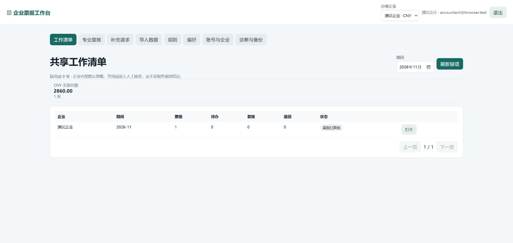
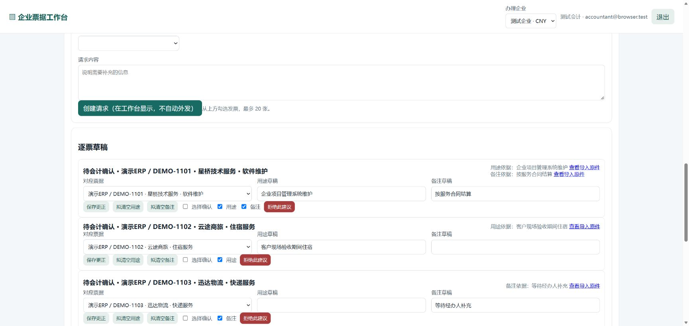
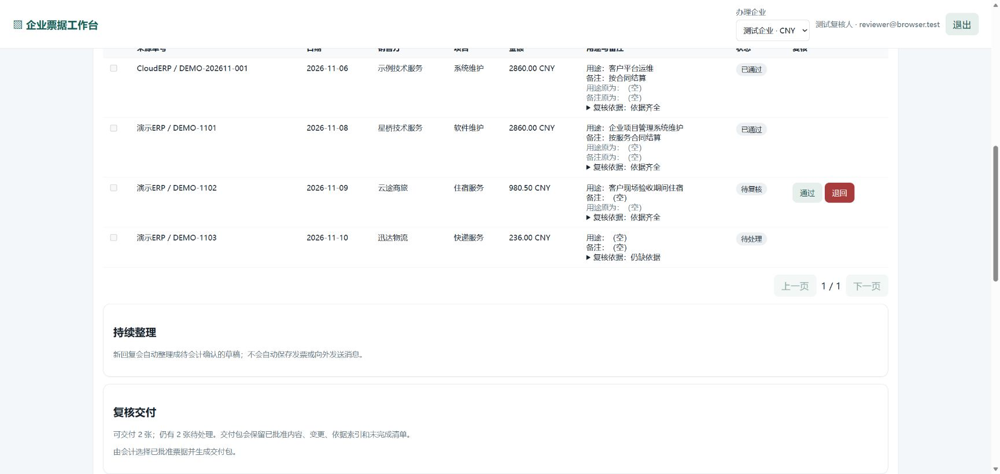

# 💼 FiscalFlow AI

### 让一张票的资料，从一句说明走到会计确认与复核交付。

**FiscalFlow AI 是一套面向代账机构和企业财务团队的智能票据协作工作台。**它把自然语言、多模态资料、任务记忆、业务规则和人工复核串成连续的办理流程：资料可以分次补，问题可以接着问，票据可以逐张确认，结果可以分批交付。

[🎬 观看产品演示](演示视频/FiscalFlow_AI_产品演示.mp4)　|　[📖 图文使用教程](使用教程/使用教程.html)　|　[🚀 启动企业工作台](启动企业工作台.cmd)　|　[💬 启动财税对话工作台](启动财税对话工作台.cmd)



---

## ✨ 从资料进入，到工作完成

一位经办人上传多张票据，再补充一句：“第一张是客户培训材料，第二张是项目验收住宿，第三张我还需要问一下。”

FiscalFlow 会围绕企业、期间和票据建立工作清单，把说明整理为逐票草稿。会计可以查看原始资料、调整用途和备注，选择需要确认的票据；复核人进入同一工作项查看并作出决定。已复核的票据可以先交付，其他事项继续跟进。

```text
📥 导入票据     💬 补充说明     🧠 AI 整理     ✍️ 会计确认     🔎 复核     📦 分批交付
   CSV / Excel → 文字 / 图片 / PDF → 逐票草稿  → 用途与备注  → 通过 / 退回 → 交付版本
```

每个环节都围绕当前工作项展开。用户更正一张票的说明时，可以继续处理相应草稿；下次打开对话，也能接着查看待办和办理进度。

## 🎯 面向实际工作的产品能力

| 财务工作中的事情 | FiscalFlow 的处理方式 |
| --- | --- |
| 票据分散在表格、数电文件和附件里 | 支持 CSV、XLSX、数电发票 XML、含结构化票据信息的 OFD，以及图片和 PDF 说明。 |
| 一次回复涉及多张票，信息完整程度不同 | 整理成逐票草稿，展示对应票据、用途、备注和待补信息。 |
| 资料来回更正，工作容易重复 | 保留草稿、更正、暂缓和当前待办，围绕变化的事项继续办理。 |
| 会计、经办人和复核人需要交接 | 每个角色在自己的工作界面查看任务、提交说明、确认草稿或进行复核。 |
| 一部分票据已经办完，另一部分还在等待 | 已复核票据可以形成交付版本，剩余事项保留在工作清单中。 |
| 需要随时查看数据与业务规则 | 按企业和期间查询发票、银行收支及用途要求，支持规则版本管理和变更影响预览。 |

### 👥 每个角色都有自己的下一步

| 角色 | 在工作台里做什么 |
| --- | --- |
| **管理员** | 创建企业、成员和角色，设置办理策略，管理工作台备份。 |
| **经办人** | 查看补充请求，提供业务说明，上传图片或 PDF 附件。 |
| **会计** | 导入资料、发起补充、整理并确认逐票草稿，组织交付。 |
| **复核人** | 查看票据、说明与相关依据，对已确认事项进行复核或退回。 |



*会计可在同一工作项中查看逐票草稿、相关说明和确认状态。*

## 🧠 技术亮点

### 01 · Agentic TaskLedger｜面向持续办理的任务账本

用事件组织任务、草稿、更正、暂缓和保存结果，将一段段对话变成可以接续的工作状态。任务账本根据当前企业、期间和目标票据形成**待补充、可处理、等待中、已完成**等工作面，让 AI 了解下一步该做什么。

### 02 · State-Aware Context Engineering｜围绕任务组织上下文

上下文编排结合当前任务、长期偏好、规则和工具结果，选择本轮需要的对话内容，并按照输入预算组织信息。系统保留重要草稿和相关原话，使长对话中的补充、更正和跨会话接续更容易衔接。

### 03 · Multimodal Document Intelligence｜图片、PDF 与文字协同理解

经办人可以将票据图片、PDF 和自然语言说明一起提交。文档处理流程读取 PDF 文本、准备页面图像，并结合视觉模型提取字段；资料再进入逐票草稿、人工核对和复核流程。

### 04 · Evidence-Grounded Drafts｜从原话到逐票建议

系统将经办人的回复关联到具体票据和字段，整理用途、备注及相关说明。会计可回看资料、更正草稿、选择字段确认，再把结果交由复核人处理。

### 05 · Rule Versioning & What-If Preview｜规则版本与影响预览

业务规则按企业、期间、生效状态和版本管理。调整用途填写要求时，可以先预览对当前票据和待办的影响，再安排后续办理。

### 06 · Human-in-the-Loop Workflow｜AI 与专业人员协作

Agent 负责理解需求、规划下一步、调用工具和自然表达；程序负责金额计算、规则执行、权限判断、数据保存和状态更新；会计与复核人完成专业判断。工作清单、原始资料、确认结果和交付版本贯穿协作过程。

### 07 · LangGraph + Tool Calling｜模型可切换的财税 Agent

基于 **LangChain / LangGraph** 组织 Agent、工具和会话；通过 **OpenAI 兼容接口**配置模型。项目已使用 **DeepSeek V4.1 Flash、Qwen 3.7 Flash 和 Qwen 3.5 Plus** 开展真实业务场景测试，覆盖多票资料整理、草稿更正、跨会话保存、复核与图片识别。

## 🧭 两个工作台

| 工作台 | 主要用途 | 启动文件 |
| --- | --- | --- |
| **企业票据工作台** | 账号与企业管理、资料导入、补充说明、草稿确认、复核和交付 | [启动企业工作台.cmd](启动企业工作台.cmd) |
| **财税对话工作台** | 自然语言查询、用途检查、多轮办理、规则和对话档案 | [启动财税对话工作台.cmd](启动财税对话工作台.cmd) |

企业工作台按企业账号组织协作数据；财税对话工作台提供内置财税示例数据，支持办件视图、对话工作区和票据核对台。

### 💬 试试这样提问

- “甲企业 2026 年 9 月的发票总额、银行收入和银行支出是多少？请说明依据。”
- “检查本期缺用途的票据，建立一个跟进任务。”
- “F003 用于寄送客户验收文件，先记草稿；F009 我还要核实，暂时保留。”
- “更正一下，F003 是寄送客户验收材料。保存这张，并告诉我还剩什么。”
- 新建对话后：“继续上次的任务，列出还需要补充的事项。”
- “如果用途必填门槛调整为 500 元，先预览会影响哪些票。”

### 📑 企业协作场景

1. **导入资料**：选择企业，上传票据文件，核对字段并确认导入。
2. **发起补充**：会计选择需要跟进的票据，向经办人提出问题。
3. **提交说明**：经办人填写文字，可附票据图片或 PDF。
4. **确认草稿**：会计查看逐票建议，补充、更正并确认相应字段。
5. **复核交付**：复核人查看并处理，会计选择已通过票据生成交付版本。



*复核页面集中展示票据、当前用途、处理状态和可交付事项。*

## 🚀 快速开始

### 第一步：准备运行环境

准备 Windows 和 **Python 3.12 或 3.13**。解压产品包后，双击 [安装运行环境.cmd](安装运行环境.cmd) 安装所需依赖。

如果你习惯命令行，也可以在 `app` 文件夹中执行：

```powershell
python -m pip install -r requirements.txt
```

### 第二步：双击启动

- 办理企业票据：双击 [启动企业工作台.cmd](启动企业工作台.cmd)。
- 体验财税自然语言办理：双击 [启动财税对话工作台.cmd](启动财税对话工作台.cmd)。

启动窗口会提示输入模型 API Key，并让你设置项目累计调用预算；输入时密钥不会显示。直接按回车可以先打开工作台，之后再配置模型。服务就绪后会自动打开默认浏览器，关闭启动窗口即可停止服务。

首次进入企业工作台时，按页面提示创建管理员，设置至少 12 位的密码，然后创建企业和成员。首次进入财税对话工作台时，系统会准备好内置示例数据。

### 第三步：导入示例票据

在企业工作台的“导入数据”中选择企业，上传 [示例票据.csv](app/示例票据.csv)，核对字段并确认。随后进入工作清单，即可体验票据补充、草稿确认、复核和交付。

财税对话工作台中的内置数据包含甲、乙两家企业及两个月的发票与银行流水。可以选择 U001 或 U002，从查询、规则与用途检查开始体验。

## 🤖 模型配置

默认配置使用 **DeepSeek**。启动时输入自己的 API Key，设置累计调用预算，即可使用自然语言办理与资料整理。

使用 **Qwen 3.7 Flash** 时，将 [Qwen 配置示例](app/config.qwen37.example.toml)复制为 `app/config.toml`，然后双击启动文件并输入对应服务的 API Key。其他 OpenAI 兼容模型也可以通过配置文件填写模型名称、服务地址和价格。

图片和 PDF 理解使用支持视觉输入的模型。处理 PDF 页面时，安装并配置 `pdfinfo`、`pdftotext` 和 `pdftoppm`。

## 🏗️ 系统结构

```text
                   👥 企业人员 / 财税用户
                            │
       ┌────────────────────┴────────────────────┐
       │                                         │
  企业票据工作台                            财税对话工作台
  导入 · 补充 · 确认 · 复核                 查询 · 追问 · 办件
       │                                         │
       └───────────────┬─────────────────────────┘
                       │
          🤖 Agent / Tool Calling / 模型接入
                       │
  TaskLedger · 上下文编排 · 多模态资料 · 规则管理
                       │
       企业业务服务 / 财税业务服务 / SQLite
```

## 📊 运行与测试

- **自动回归**：337 项检查覆盖票据、任务、规则、权限、资料、复核和交付。
- **批量导入**：500 张模拟票据形成会计待确认清单耗时 **0.108 秒**；可信来源导入时同步字段并生成复核事项耗时 **1.846 秒**。
- **真实模型**：DeepSeek、Qwen 3.7 Flash、Qwen 3.5 Plus 已参与业务场景测试。

[查看模型运行记录](运行记录/模型运行记录.md)　|　[查看批量导入结果](运行记录/批量导入结果.json)　|　[查看设计说明](文档/设计说明.md)

## 📚 随包资料

```text
FiscalFlow-AI/
├─ README.md                  产品介绍
├─ 安装运行环境.cmd            首次安装依赖
├─ 启动企业工作台.cmd          企业票据协作入口
├─ 启动财税对话工作台.cmd      自然语言财税办理入口
├─ app/                       应用源码、模型配置与示例票据
├─ 使用教程/                  图文教程
├─ 产品截图/                  工作台实景
├─ 文档/                      产品设计说明
├─ 运行记录/                  模型、业务与性能结果
└─ 演示视频/                  产品实际操作演示
```

[📖 打开图文使用教程](使用教程/使用教程.html)　|　[📝 查看可编辑教程](使用教程/使用教程.md)　|　[🎬 观看产品演示](演示视频/FiscalFlow_AI_产品演示.mp4)
