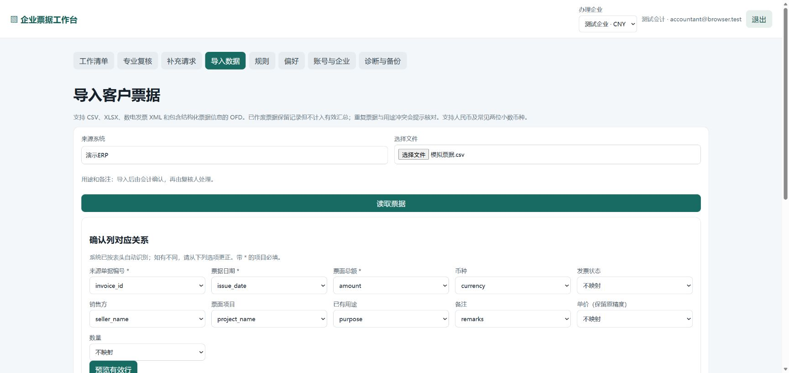
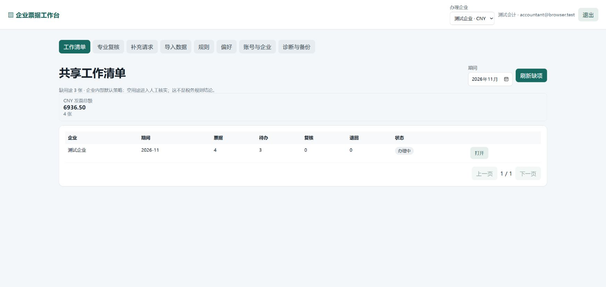
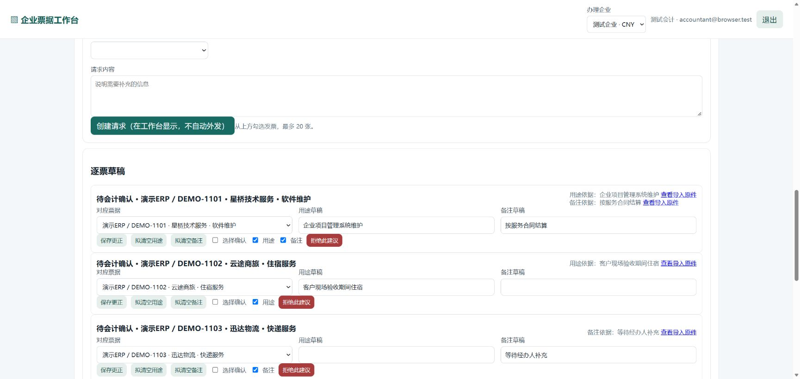
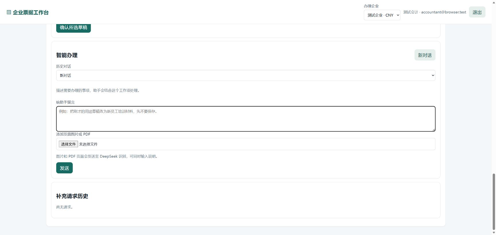
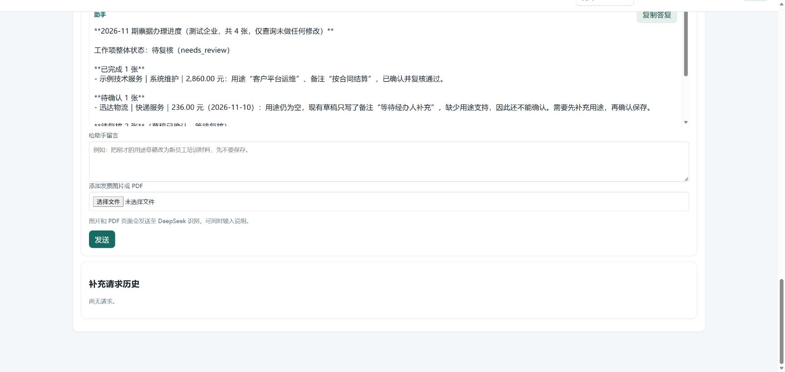
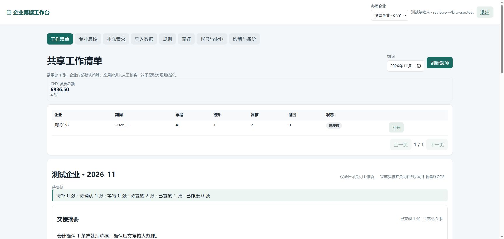
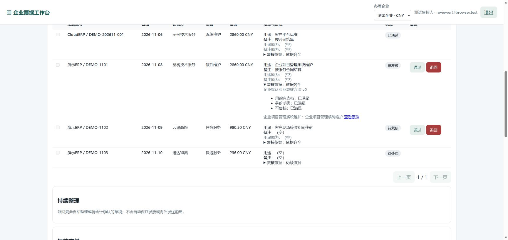
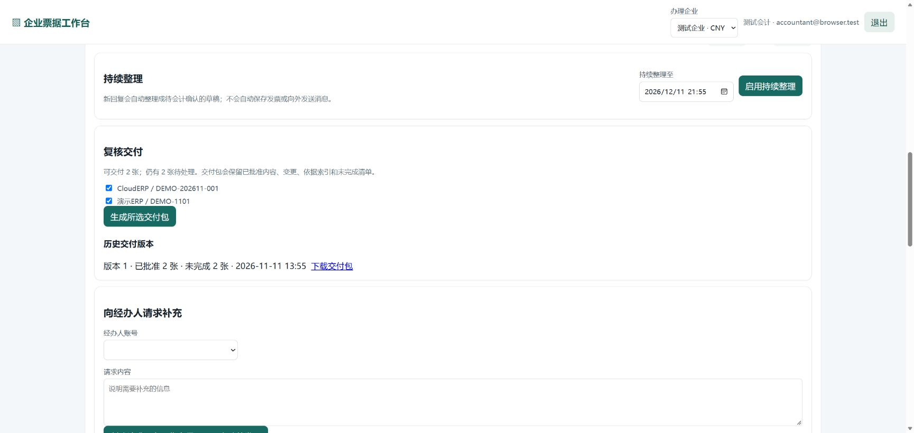
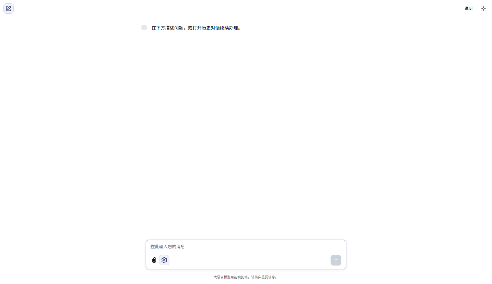

# FiscalFlow AI 使用教程

**从第一次打开工作台，到票据补充、确认、复核和交付。** 本教程面向企业管理员、会计、经办人、复核人和体验评审，使用入门中文和可直接照做的样例。

> 🧪 **截图与示例说明**：图中账号、企业、票据、金额与对话均为模拟数据。每张截图保留原始画面，图注标明对应角色。示例输入可以直接照着改写；实际办理时请选择自己的企业和期间。

## 🧭 先选工作台

FiscalFlow AI 有两个入口，分别处理团队协作和自然语言财税任务：

| 工作台 | 适合做什么 | 从哪里打开 |
| --- | --- | --- |
| 企业票据工作台 | 企业和成员设置、导入票据、发起补充、逐票整理、会计确认、独立复核、分批交付 | 双击 [启动企业工作台.cmd](../启动企业工作台.cmd) |
| 财税对话工作台 | 用自然语言查询发票和银行金额、检查用途缺项、保存草稿、查看适用规则和继续历史对话 | 双击 [启动财税对话工作台.cmd](../启动财税对话工作台.cmd) |

> 💡 第一次使用前，双击根目录的[安装运行环境.cmd](../安装运行环境.cmd)完成一次性准备。之后每次使用时双击相应工作台的启动脚本；启动窗口会询问模型 API Key（可回车跳过）和累计预算。需要 AI 对话或图片/PDF 整理时，按提示输入可用的 API Key 并设置可接受的累计预算；暂时不需要模型功能时可跳过。服务就绪后浏览器会自动打开。
>
> 本教程的主线是企业票据工作台。管理员先完成初始化和角色分配；之后会计、经办人和复核人按各自步骤接力。两个工作台的用户与业务资料分别维护。

## 👥 谁来做哪一步

| 角色 | 常见任务 |
| --- | --- |
| 系统管理员 | 首次创建管理员；新建企业和账号；为账号分配企业角色。 |
| 会计 | 导入票据；发起补充；查看经办人回复；更正、确认逐票草稿；复核完成后生成交付并关闭工作项。 |
| 经办人 | 在“补充请求”中打开分配给自己的请求，填写业务说明，可附图片或 PDF。 |
| 复核人 | 查看票据、原件和复核依据；通过或退回待复核票据。 |

管理员是在系统层面管理账号和企业；“会计、经办人、复核人”是在选定企业中的工作角色。给每位成员分配正确企业和角色后，他们登录即可看到对应任务。

**一张票的标准交接顺序：**会计发起补充 → 经办人回复文字或图片/PDF → 会计核对并确认草稿 → 复核人通过或退回 → 会计纳入交付。演练时请分别使用对应角色账号登录，按顺序查看同一张票在各步骤的变化。

## 1. 🔰 首次打开：创建管理员和企业

1. 如果还没有完成一次性运行环境安装，先双击根目录的[安装运行环境.cmd](../安装运行环境.cmd)。然后双击[启动企业工作台.cmd](../启动企业工作台.cmd)。首次启动时，页面会显示“首次设置管理员”。
2. 填写登录账号、显示名称和密码，然后选择“创建管理员并登录”。登录账号至少 3 个字符；初始密码至少 12 个字符。
3. 打开“账号与企业”，在“新建企业”中填写企业名称和默认币种。若团队要求独立复核，保留“要求独立复核”的勾选。
4. 在“新建账号”中为会计、经办人和复核人分别创建登录账号；再在“分配企业角色”中选择账号、企业与角色，保存授权。
5. 如需指定没有适用规则时的处理方式，在同页选择对应企业的默认策略并保存。完成后，顶部“办理企业”选择本次要处理的企业。

✅ **准备完成**：至少有一个企业、一个会计账号；演练补充流程时再准备一个经办人账号和一个复核人账号。

## 2. 📥 导入样例票据

交付包内附有 [示例票据.csv](../app/示例票据.csv)，可以用于熟悉导入步骤。示例行包含票据日期、金额、销售方、项目、用途和备注；其中部分票据用途留空，便于观察后续核对流程。

1. 以管理员或会计账号登录，选择目标企业，打开“导入数据”。
2. 在“来源系统”填写便于团队识别的名称，选择 `示例票据.csv`，点击“读取票据”。企业票据导入支持 CSV、XLSX、数电发票 XML 和含结构化票据信息的 OFD。
3. 检查列对应关系。必填列是“来源单据编号”“票据日期”“票面总额”；币种、销售方、票面项目、已有用途和备注可按文件列映射。
4. 点击“预览有效行”，检查可导入行和需人工处理的行；确认金额、日期、票据号与字段映射无误后，点击“确认导入有效行”。
5. 返回“工作清单”，选择期间并打开对应工作项。重复票据、字段冲突或异常行会在界面提示，先查看提示再继续。

*会计角色 · 导入数据页。录屏中选取了演示 CSV，页面展示自动识别的字段映射；示例文件名和票据值以实际选择的样例为准。*

## 3. 🗂️ 从工作清单打开工作项

“工作清单”按企业和期间汇总票据数、待办数、待复核数、退回数和工作项状态。会计可在期间筛选器切换月份，选择“打开”进入票据明细。

*会计角色 · 工作清单中的企业与期间汇总。截图内企业、期间、数量和金额均为演示用模拟数据。*

打开工作项后，先看顶部进度摘要：待补、待确认、等待、待复核、已复核、已作废各有多少张。下面的票据表格会列出来源单号、日期、销售方、项目、金额、用途与备注、当前状态以及复核结果。点击票据旁的原件链接，可回看导入来源。

## 4. ✉️ 发起补充，请经办人补齐资料

会计在工作项的票据表格中勾选需要补充的票据，在“向经办人请求补充”区域选择经办人账号，写清要补充什么，再点击“创建请求”。一次最多选 20 张票。

**可直接改写的请求示例：**

> 请补充 DEMO-004 对应的实际业务用途；如有合同、验收单或其他说明，请一并附上。若无法提供，也请说明原因。

请求会显示在企业工作台的“补充请求”中，不会自动向外发送消息。经办人登录后打开“补充请求”，选择分配给自己的记录，填写业务说明；有相关资料时，使用附件框添加图片或 PDF，再提交回复。

*会计角色 · 工作项内的“逐票草稿”和补充请求区域。截图展示可编辑的票据匹配、用途草稿与备注草稿；演示中的票据及内容均为模拟数据。*

### 图片或 PDF 作为补充资料

经办人在补充回复表单中，可以只写文字、只附资料，或同时提交文字和附件。也可以更正先前回复，或说明无法提供。提交后，原始回复与附件会保留在该请求的历史中，会计可从“查看回复”进入整理。

**回复示例：**

> DEMO-004 是为客户现场验收准备的材料印刷服务。附件是对应的验收通知，请核对票号和日期后再整理用途草稿。

*会计角色 · 工作项“智能办理”输入区，包含文字输入框和“添加发票图片或 PDF”附件入口。示例文字和附件应围绕当前企业与工作项填写。*

## 5. 🧠 让智能办理整理说明和图片/PDF

工作项中的“智能办理”适合查询进度、整理自然语言说明，或把图片/PDF与文字一起交给助手参考。先确认顶部选中的企业与工作项，再在文字框说明任务；需要附件时点击“添加发票图片或 PDF”选择文件，最后点击“发送”。提交后查看整理状态和回复，再回到逐票草稿核对。

**只查询的示例输入：**

> 请概括本期票据的办理进度，哪些待确认，哪些待复核？只查询，不修改。

**带附件的示例输入：**

> 请结合这份 DEMO-004 的说明图片，整理可识别的票号、用途候选和原文依据。若信息不完整，请列出还需要会计核对的内容；先不要确认保存。

*会计角色 · 工作项“智能办理”的查询答复与图片/PDF入口。截图中的办理进度和票据内容均为模拟数据。*

图片/PDF进入整理后，候选用途会进入会计可检查的草稿；查看附件原件、识别页和引用依据，确认票据对应正确后再继续。若附件仍在整理、识别失败或提示需要澄清，先查看状态并补充说明，必要时重试；不要把候选内容当成已经保存的发票用途。

> ℹ️ 智能办理需要管理员按交付包的模型配置启用。若当前实例未配置，仍可按本教程使用导入、人工补充、会计确认、复核和交付流程。

## 6. 🧾 整理逐票草稿并由会计确认

经办人的一段回复可能提到多张票。会计打开补充请求的回复历史，在需要整理的回复上选择“整理为逐票草稿”。整理完成后回到工作项的“逐票草稿”，逐张处理：

1. 核对草稿匹配的来源票据；若匹配错误，先选择正确票据。
2. 阅读“用途草稿”和“备注草稿”，与经办人原话、图片/PDF原件及来源依据对照。按需要修改草稿，再点“保存更正”。
3. 对需要清空的字段，先选择“拟清空用途”或“拟清空备注”，再核对确认项。
4. 在“选择确认”中勾选要提交的草稿及要确认的字段。页面会列出当前可确认的字段；没有准备好的字段不必勾选。
5. 点击“确认所选草稿”。确认后回看工作项和票据表格，检查用途、备注和状态已更新。

*会计角色 · 每条草稿独立显示关联票据、用途、备注和确认选项。只确认已核对的字段；有冲突或澄清提示时先处理提示。*

> ✅ **一条好用的习惯**：先看票据匹配，再看用途和备注，最后选择确认。草稿可以保存更正，只有明确确认的字段才进入票据记录。

若草稿显示“需要澄清”、经办人表示“无法提供”、来源状态变化或字段冲突，先查明情况并记录下一步；未处理的草稿不应直接跳过。退回后重新整理的回复仍可以保留在原请求里。

## 7. 🔎 复核人检查并通过或退回

1. 复核人使用自己的账号登录同一企业，打开“工作清单”并选择待复核工作项。
2. 检查待复核票据的用途、备注和原始票据；展开“复核依据”，查看当前方法、必需条件、来源原话和可打开的原件。
3. 信息和依据符合团队要求时点击“通过”；需要补资料或更正时点击“退回”，让会计继续处理后再复核。
4. 复核结束后刷新工作清单，确认票据状态和待复核数量变化。

*复核人角色 · 复核人只能处理授权范围内的复核动作；工作清单显示待复核数量。截图数字为模拟数据。*

*复核人角色 · 已展开单张票的复核依据，可查看方法版本、条件状态及对应支持材料。截图中的方法和票据为演示数据。*

## 8. 📦 生成交付版本并完成工作项

会计可以按已通过的票据分批交付；还有票据待补或待复核时，可先交付已批准部分，剩余事项继续留在工作项。

1. 由会计打开工作项，滚动到“复核交付”。勾选本次要交付的已批准票据，点击“生成所选交付包”。
2. 新版本会出现在“历史交付版本”中。打开“下载交付包”可取得本次交付资料；交付包会保留已批准内容、变更、依据索引和未完成清单。
3. 其他票据处理完后，再选择下一批票据生成新的交付版本。
4. 全部票据均已复核或按授权明确处置后，会计点击“关闭”。关闭后可从工作项下载最终 CSV；仍有事项未处理时，先继续办理。

*会计角色 · 交付区列出本次选择的已批准票据，并显示历史交付版本。截图中的企业、票据与交付数量均为模拟数据。*

## 9. 💬 财税对话工作台：查询、草稿和会话历史

双击 [启动财税对话工作台.cmd](../启动财税对话工作台.cmd)，服务就绪后浏览器会自动打开。在工作台设置中选择示例用户和当前企业，然后在对话框输入请求。财税对话需要模型提供回答；若启动时跳过 API Key，可先完成后续配置再开始提问。

**查询示例：**

> 甲企业 2026 年 9 月发票总额、银行收入和银行支出是多少？请说明统计依据。

**创建跟进任务的示例：**

> 检查甲企业 2026 年 9 月哪些发票缺用途，并建立一个跟进任务。

**先写草稿、保留待核事项的示例：**

> F003 用于寄送客户验收文件，先记草稿。F009 我需要再核实，暂时保留。

如需更正，说明更正哪张票和字段，以及是否保存；再按回复逐项检查。示例体验数据包含甲、乙企业的不同票据和权限，页面显示的统计范围取决于当前选择的用户、企业和月份。

*财税对话工作台：输入问题，开始查询和办理。*

查看一条回复下方的“本轮过程”，可以展开本轮模型输入、当前任务与规则、工具调用和结果。点击“对话档案”可以查看以前的会话或继续原会话；选择“新对话”会新开一段交流，原有会话仍可从档案查看。

## 10. 📚 规则、偏好与工作历史

- **规则**：先选定企业和月份，再查看适用规则及其范围。具备会计授权的成员可按页面提供的功能管理规则。修改规则时先查看预览影响，再决定是否发布。
- **专业复核方法**：会计可按企业和期间查看复核依据；调整方法时先预览受影响票据和缺口，再决定是否发布新版本。
- **偏好**：设置个人表达偏好，选择作用范围为个人所有企业或当前企业。偏好只影响回复表达。
- **企业工作项中的对话历史**：在“智能办理”顶部选择本工作项的历史对话，可以回看或继续；“新对话”会在同一工作项下开启新的交流。
- **财税对话档案**：查看或继续先前的会话，也可开启新会话。原有历史可以随时返回。

## ✅ 一次完整演练的完成清单

- [ ] 管理员已创建企业，并为会计、经办人、复核人分配账号与角色。
- [ ] 会计导入样例 CSV，核对字段映射和导入预览。
- [ ] 会计为用途待补票据发起请求；经办人提交文字说明，并可附图片/PDF。
- [ ] 会计检查逐票草稿，完成必要更正后确认准备好的字段。
- [ ] 复核人查看原件和复核依据，对票据通过或退回。
- [ ] 会计按需分批生成交付版本；事项办结后关闭工作项并下载最终 CSV。
- [ ] 在财税对话工作台试做一次查询，并查看“本轮过程”和历史会话。

如果页面显示的按钮与当前角色不同，先确认登录账号、顶部所选企业以及该账号在此企业中的授权角色。
